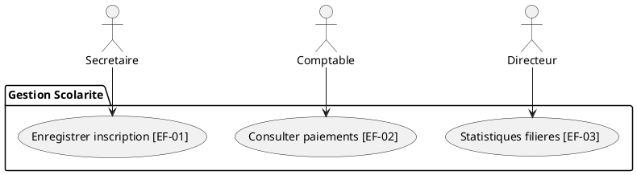

### 3.3.1 Pourquoi modéliser avec UML ?

Un cahier des charges de 50 pages de texte brut contient inévitablement des contradictions, des zones d'ombre ou des ambiguïtés. Un **modèle** est une abstraction visuelle simplifiée qui ne retient que les aspects pertinents du système pour concevoir sa solution logicielle :

```text
[ BESOINS ]           [ EXIGENCES ]         [ MODÈLES UML ]        [ CONCEPTION & CODE ]
Ce que veulent        Ce que le système     Vue graphique           Comment programmer
les utilisateurs      doit accomplir        structurée              la solution
```

**UML 2.0** (*Unified Modeling Language*) est le standard international de modélisation orientée objet.

---

### 3.3.2 Quel diagramme UML pour quelle question ?

| Question posée par l'analyste | Diagramme UML adapté | Exemple au Centre Avenir Formation |
|---|---|---|
| **Qui utilise le système et pour quel service ?** | **Diagramme de Cas d'Utilisation** (*Use Case*) | La secrétaire enregistre une inscription ; le comptable consulte les soldes. |
| **Quelles informations et structures de données manipule-t-on ?** | **Diagramme de Classes** | Classes `Apprenant`, `Filiere`, `Paiement`, `Bulletin` et leurs relations. |
| **Dans quel ordre chronologique les objets s'échangent-ils des messages ?** | **Diagramme de Séquence** | Messages échangés entre `IHM_Inscription`, `ControleurScolarite` et `BDD`. |
| **Comment les étapes algorithmiques s'enchaînent-elles dans le système ?** | **Diagramme d'Activités** | Algorithme de contrôle des prérequis et de calcul de la moyenne générale. |
| **Par quels états successifs passe une entité du domaine ?** | **Diagramme d'États-Transitions** | Cycle de vie d'un dossier : *Brouillon* $\to$ *En attente* $\to$ *Validé* $\to$ *Archivé*. |

---

### 3.3.3 Le diagramme de cas d'utilisation

Un **cas d'utilisation** (*Use Case*) représente un service fonctionnel complet rendu par le système informatique à un **acteur** externe (humain ou machine). Chaque cas d'utilisation est directement relié au code d'une exigence fonctionnelle :

```text
                 +------------------------------------------+
                 |    SYSTÈME DE GESTION DES INSCRIPTIONS    |
                 |                                          |
( Secrétaire ) ------> ( Enregistrer une inscription ) [EF-01]
                 |                                          |
( Comptable ) -------> ( Consulter l'état des paiements ) [EF-02]
                 |                                          |
( Directeur ) -------> ( Obtenir les effectifs par filière ) [EF-03]
                 +------------------------------------------+
```



---

### 3.3.4 La matrice de traçabilité des exigences

La **traçabilité** est la capacité de suivre une exigence **dans les deux sens** :
- **Traçabilité amont** : remonter de l'exigence au besoin exprimé par l'utilisateur ;
- **Traçabilité aval** : relier l'exigence aux modèles de conception, puis aux composants logiciels et aux tests de validation.

| N° Exigence | Type & Priorité | Cas d'utilisation UML | Scénario de test de validation |
|---|---|---|---|
| **EF-01** | Fonctionnelle (Must) | Enregistrer une inscription | Saisir deux fois le même matricule : le système bloque et affiche un message d'erreur explicite. |
| **EF-02** | Fonctionnelle (Must) | Consulter les paiements | Sélectionner un apprenant ayant versé 2 mensualités sur 3 : le reste à payer affiché correspond exactement à 1 mensualité. |
| **EF-03** | Fonctionnelle (Should) | Obtenir les inscrits | Pour 12 inscriptions validées en filière Réseaux, l'indicateur consolidé affiche exactement 12. |
| **ENF-01** | Performance (Should) | Global | Chronométrer 20 saisies consécutives : aucune ne dépasse 3 secondes de temps de réponse. |

:::retenir L'intérêt d'une matrice de traçabilité
1. **Garantir la couverture des tests** : vérifier qu'aucune exigence n'est livrée sans son test associé ;
2. **Détecter les dérives** : repérer un cas d'utilisation orphelin qui ne répond à aucune exigence du client ;
3. **Réaliser l'analyse d'impact** : si une règle change, savoir immédiatement quels modèles et quels tests doivent être mis à jour.
:::

---

### 3.3.5 Maîtriser le changement d'exigences

Dans un projet réel, les exigences changent inévitablement en cours de route. On applique une procédure formelle en quatre étapes :

```text
1. Demande écrite      2. Analyse d'impact     3. Décision formelle     4. Mise à jour
   (Qui demande quoi)  -> (Délais, coûts, code) -> (Acceptée / Reportée) -> (Spécifications, tests)
```

:::attention Jamais d'accord oral informel !
Accepter une modification « entre deux portes » sans tracer l'impact contractuel sur les délais et le budget déséquilibre le projet et conduit inévitablement au conflit lors de la livraison.
:::
