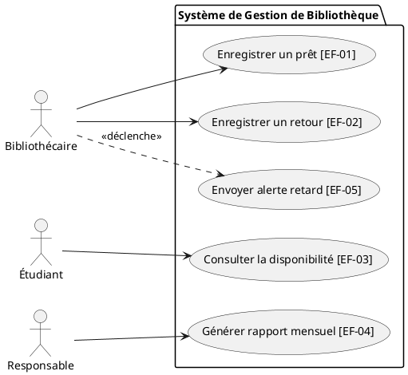

### B.1 Énoncé de l'étude de cas d'examen

La bibliothèque d'un institut universitaire gère actuellement l'ensemble de ses prêts et retours d'ouvrages à l'aide d'un grand cahier manuscrit :
- **Constats opérationnels** :
  - Le bibliothécaire passe un temps excessif à feuilleter le cahier pour retrouver qui a emprunté un livre donné et relancer les retards ;
  - Les étudiants se déplacent souvent pour rien car ils ne peuvent pas vérifier la disponibilité d'un ouvrage avant de venir sur place ;
  - Le responsable pédagogique souhaiterait disposer, le premier de chaque mois, du classement des livres les plus empruntés afin d'orienter les acquisitions ;
  - La bibliothèque est ouverte de 8h à 17h, du lundi au vendredi.
- **Contraintes du projet** :
  - L'application doit être opérationnelle dans **6 semaines**, pour la rentrée universitaire ;
  - L'équipe de développement comprend **deux développeurs** à temps plein ;
  - Le budget est restreint : si les délais se resserrent, il faudra arbitrer sur le périmètre.

---

### B.2 Étape 1 : Cartographie des parties prenantes

On positionne les acteurs sur la matrice **Influence $\times$ Intérêt** :
1. **Responsable de la bibliothèque** : *Collaborer étroitement* (Forte influence, Fort intérêt - finance et valide).
2. **Bibliothécaire** : *Tenir informé / Écouter* (Faible influence formelle, Très fort intérêt - utilisateur quotidien clé).
3. **Étudiants** : *Tenir informé / Écouter* (Bénéficiaires directs du service de consultation).
4. **Direction de l'institut / Tutelle** : *Tenir satisfait* (Forte influence budgétaire, Faible intérêt opérationnel direct).

---

### B.3 Étape 2 : Spécification et priorisation des exigences (MoSCoW)

| Code | Énoncé de l'exigence | Type | Priorité MoSCoW | Justification |
|---|---|---|:---:|---|
| **EF-01** | Le système doit permettre au bibliothécaire d'enregistrer le prêt d'un livre à un étudiant et d'en bloquer le prêt s'il est déjà emprunté. | Fonctionnelle | **Must** | Fonctionnalité vitale sans laquelle le système ne remplit pas sa mission de base. |
| **EF-02** | Le système doit permettre au bibliothécaire d'enregistrer le retour d'un livre et d'indiquer les retards de restitution. | Fonctionnelle | **Must** | Indispensable pour remettre les livres en circulation et suivre les emprunts. |
| **EF-03** | Le système doit permettre aux étudiants de rechercher un livre par titre ou auteur et de consulter sa disponibilité en temps réel. | Fonctionnelle | **Should** | Réduit les déplacements inutiles des étudiants, valeur ajoutée majeure. |
| **EF-04** | Le système doit générer chaque mois le rapport statistique des 10 ouvrages les plus empruntés pour le responsable. | Fonctionnelle | **Should** | Permet le pilotage des acquisitions par la direction. |
| **EF-05** | Le système doit envoyer une notification de rappel par e-mail à l'étudiant 48h avant l'échéance de son prêt. | Fonctionnelle | **Could** | Fonction de confort : sera abandonnée en premier si le calendrier prend du retard. |
| **ENF-01** | La recherche d'un ouvrage dans le catalogue doit afficher les résultats en **moins de 2 secondes**. | Performance | **Should** | Garantit la fluidité de consultation en ligne. |
| **ENF-02** | L'accès aux fonctions d'emprunt et de retour doit être sécurisé et réservé aux comptes bibliothécaires authentifiés. | Sécurité | **Must** | Protection de l'intégrité des stocks de la bibliothèque. |

---

### B.4 Étape 3 : Diagramme de Cas d'Utilisation UML

---

### B.5 Étape 4 : Matrice de traçabilité des exigences

| Exigence | Cas d'utilisation | Protocole de test de recette | Résultat attendu |
|---|---|---|---|
| **EF-01** | Enregistrer un prêt | Tenter d'enregistrer un second prêt pour un exemplaire déjà marqué emprunté. | Le système refuse l'opération avec une alerte : *« Ouvrage déjà en cours de prêt »*. |
| **EF-02** | Enregistrer un retour | Enregistrer le retour d'un livre 5 jours après la date butoir. | L'état du livre redevient disponible et une pénalité de retard est journalisée. |
| **EF-03** | Consulter disponibilité | Rechercher un livre dont tous les exemplaires sont empruntés. | La mention *« Aucun exemplaire disponible actuellement »* s'affiche. |
| **EF-04** | Générer rapport | Simuler 15 prêts sur un mois et déclencher l'export du rapport. | Un tableau PDF/Excel synthétisant le top des prêts est édité en moins de 3 secondes. |

---

### B.6 Étape 5 : Planification agile en 3 Sprints Scrum de 2 semaines

Avec 2 développeurs travaillant sur 6 semaines, on dispose de 3 Sprints de 2 semaines (soit environ 20 jours-homme par sprint au total) :

- **Sprint 1 (Semaines 1 et 2)** : Socle de données et gestion des prêts
  - *Objectif* : Avoir un système fonctionnel permettant d'enregistrer et de clore un prêt d'ouvrage.
  - *Contenu* : Schéma de base de données, authentification (ENF-02), EF-01 (Prêts) et EF-02 (Retours).
- **Sprint 2 (Semaines 3 et 4)** : Consultation publique et performances
  - *Objectif* : Ouvrir la recherche en ligne aux étudiants avec d'excellents temps de réponse.
  - *Contenu* : EF-03 (Moteur de recherche du catalogue), ENF-01 (Optimisation des requêtes < 2s).
- **Sprint 3 (Semaines 5 et 6)** : Statistiques, confort et recette finale
  - *Objectif* : Fournir les rapports à la direction et finaliser la recette.
  - *Contenu* : EF-04 (Statistiques mensuelles), EF-05 (*Could* : e-mails si le temps le permet), recette globale et formation du bibliothécaire.
